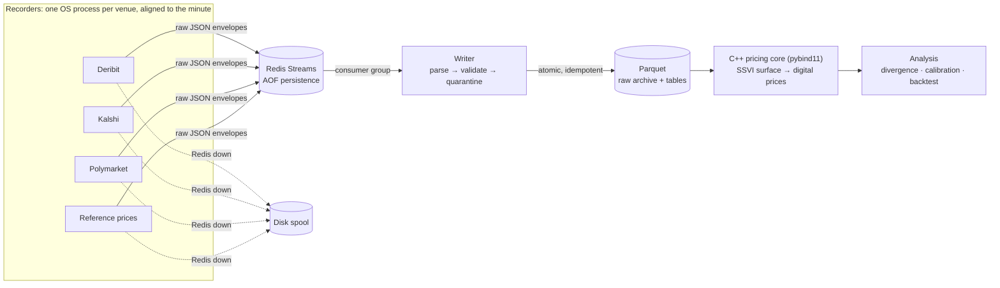

# implied-odds

**Do prediction markets price Bitcoin the same way the options market does?**

A Kalshi or Polymarket contract like *"BTC above $95,000 at 5 pm ET"* pays $1 or $0, which makes it
a **digital option**. Deribit lists thousands of ordinary BTC options whose prices imply a full
probability distribution for the future price. This project records both markets side by side, fits
an arbitrage-free volatility surface to the options, prices every prediction-market contract off that
surface, and tests whether the gaps survive fees, hedging costs and the venues' different settlement rules.

> **Status: Phase 0 of 5 (data recording) in progress.** The recording pipeline is built, tested and
> recording four venues live. The pricing library and analysis are designed but not built yet.
> Research only, with paper trading: this project never places real orders.

---

## Why it's harder than it looks

- **A digital isn't N(d2).** Under a volatility smile, P(S > K) = N(d2) − (1/D)·Vega·∂σ/∂K. Ignoring the skew
  term misprices exactly the contracts where prediction markets trade most.
- **Every venue settles on a different number at a different time:**

  | Venue | Settles on | When |
  |---|---|---|
  | Deribit options | Deribit BTC index (averaging method being confirmed) | 08:00 UTC |
  | Kalshi | 60-second average of CF Benchmarks BRTI (USD) | Hourly and daily, ET |
  | Polymarket | Close of the Binance BTC/**USDT** 1-minute candle | Noon ET |

  The surface must be interpolated in time to each contract's exact settlement, so it has to be free of
  calendar arbitrage. The settlement indices also differ: in one snapshot Binance BTC/USDT sat about 0.14%
  above Coinbase BTC/USD.
- **Options give risk-neutral probabilities.** Some of any gap is a risk premium, not a mispricing.
- **Historical order books can't be bought.** Every minute not recorded is lost, so the recorder has to be
  reliable before any research can start.

## What's built

| Area | State |
|---|---|
| Fault-tolerant recording pipeline (recorders → Redis Streams → Parquet writer) | ✅ Built, tested, running |
| Deribit: full BTC + ETH option chains, futures, index | ✅ Recording |
| Kalshi: every open BTC/ETH "above" and range market | ✅ Recording |
| Polymarket: BTC/ETH "above" and range ladders, 5-level order books | ✅ Recording |
| Reference prices: Binance 1m candles (Polymarket's settlement), Coinbase (BRTI proxy) | ✅ Recording |
| Settlement collector: Kalshi results + actual BRTI values, Polymarket resolutions, Binance settlement candles | ✅ Running hourly |
| Daily merge + hash-chained manifest, failure/kill tests | 🔨 Next |
| Docker image + Compose for every service, with restart policies; kill-tested | ✅ Built |
| Cloud VM (Terraform, AWS Lightsail) + nightly S3 backup | 🔨 Next |
| Prometheus/Grafana, health checks, alerts | 📋 Planned |
| C++ pricing core: Black-76, IV solver, SVI/SSVI fit, arbitrage checks, skew-corrected digitals | 📋 Planned |
| Contract matching, divergence analysis, calibration, backtest with costs | 📋 Planned |

## Architecture



**Delivery guarantee: at-least-once delivery plus idempotent writes, which together act as exactly-once.**

| Failure | What happens | How it's handled |
|---|---|---|
| One venue's API breaks or changes | Only that venue's process is affected | Separate processes. The bad response is quarantined with a reason, and the gap is logged with its cause |
| Writer crashes mid-batch | Messages it took but didn't finish stay pending in Redis | Ack only after files are durable. On restart, pending messages are re-read before new ones |
| Same message delivered twice | It would duplicate rows | File names derive from (tick, venue, request), so a replay overwrites the identical file |
| Crash while writing a file | It would leave a half-written file | Write to a temp file, `fsync`, then atomic rename |
| Redis unreachable | Recorders can't publish | Each recorder spools to disk (bounded) and replays in order. A drop happens only if the spool is full, and is logged as `DATA LOSS` |
| Venue changes a field's type | It would silently corrupt the data | Explicit Arrow schemas. Bad rows go to quarantine, never into the tables |
| Machine sleeps through a tick | Current prices would be stored under an old timestamp | A tick woken more than 5 s late is skipped and logged, never stored under the wrong time |

Design notes with the decisions and the options rejected: [`docs/design/recorder-pipeline.md`](docs/design/recorder-pipeline.md).

## Engineering decisions

- **Raw responses on the queue (ELT).** Recorders don't parse; the writer does. A parser bug found in week 3 is
  fixed by replaying the raw archive, and recorders, the part that must never fail, stay tiny.
- **One message per natural unit.** A whole option chain or one ladder of mutually exclusive brackets is one
  message, so a minute's snapshot is never half-written.
- **Pure parsers tested against real saved responses.** The riskiest code is also the easiest to test.
  Example: Polymarket's CLOB lists the best price *last*, and a test proves the parser never takes the first element blindly.
- **Star schema for Polymarket.** Contract terms (strike, settle time, fees) and minute-by-minute books are
  separate tables. Joining them in the writer would make output depend on message order.
- **Async fetching.** All of a venue's endpoints are requested together, so each snapshot is internally aligned.

## Measured so far

All numbers below were measured on a laptop and are recorded in the project log. Nothing is estimated.

| Metric | Value |
|---|---|
| Rows per minute | ~1,640 Deribit options · 1,416 Kalshi markets · 220 Polymarket books |
| Fetch latency (median) | Deribit 343 ms · Kalshi ~350 ms · Polymarket 364 ms |
| Alignment within a Deribit snapshot | All 6 responses within 11–65 ms of each other |
| Writer crash recovery | 18 queued snapshots drained in < 8 s, 0 lost, 0 duplicated |
| Writer SIGKILL under Docker Compose | Restarted in 0.9 s; 146/146 messages written exactly once |
| Rows quarantined in live runs | 0 |
| Polymarket range-ladder sanity check | Mid prices sum to 1.024 (≈ 1 plus the bid-ask spread) |
| Settlement cross-check | All 22 resolved Polymarket BTC contracts on 2026-11-10 agree with the Binance noon close and our bracket rules |
| Kalshi settlement delay after close | Median 166 s (max 731 s) |
| Laptop overnight coverage | **12.6%**: the Mac slept on battery. This is why the recorder moves to a cloud VM next |

Not yet measured: kill and network-cut tests under load, Redis outage replay, and multi-week uptime. These are on the Phase 0 checklist.

## Stack

- **Python 3.11:** asyncio + httpx, Redis Streams (redis-py), Apache Arrow / Parquet (pyarrow), pytest, ruff, uv
- **C++20:** core library exposed to Python with pybind11; CMake presets, GoogleTest, Google Benchmark
- **Infra:** Docker (multi-stage image) and Docker Compose, Redis with AOF, GitHub Actions CI on Ubuntu and macOS; next: Terraform on AWS (Lightsail + S3); planned: Prometheus, Grafana

## Repository layout

```text
cpp/                  C++ core (pricing, surface, solvers); tests and benchmarks
python/ppm/
  pipeline/           envelope, Redis bus with disk spool, minute clock
  recorders/          deribit, kalshi, polymarket, reference, settlements
  writer/             parsers, Arrow schemas, atomic storage, consumer loop
  tests/              unit tests + real API responses as fixtures
docs/PLAN.md          math, data sources, phases and checklists
docs/design/          design documents with decisions and trade-offs
scripts/recording.sh  start / stop / status for local recording
```

## Run it

```bash
uv sync && uv run pytest                    # Python tests (also builds the C++ extension)
cmake --preset dev && cmake --build --preset dev && ctest --preset dev   # C++ tests

docker compose up -d --build               # Redis + writer + every recorder, auto-restarting
docker compose ps                           # status and restart counts
docker compose logs -f kalshi               # one service's log
docker compose down                         # stop (data and the Redis volume are kept)
```

All venue data used is public; no API keys are needed.

## Roadmap

0. **Data recording**: pipeline, recorders and settlement collector (built); cloud VM, hash-chained daily files, monitoring (next)
1. **C++ core**: Black-76 and Greeks, implied-vol solver, SVI per expiry and SSVI across expiries, arbitrage checks
2. **Digital pricing**: skew-corrected digital and range prices, density extraction
3. **Matching**: map each contract to strike, settlement time and index; query the surface at that exact time
4. **Analysis**: divergence over time, calibration against realised outcomes
5. **Backtest**: paper strategy with fees, spreads and hedging costs, with a data-coverage report alongside every result
