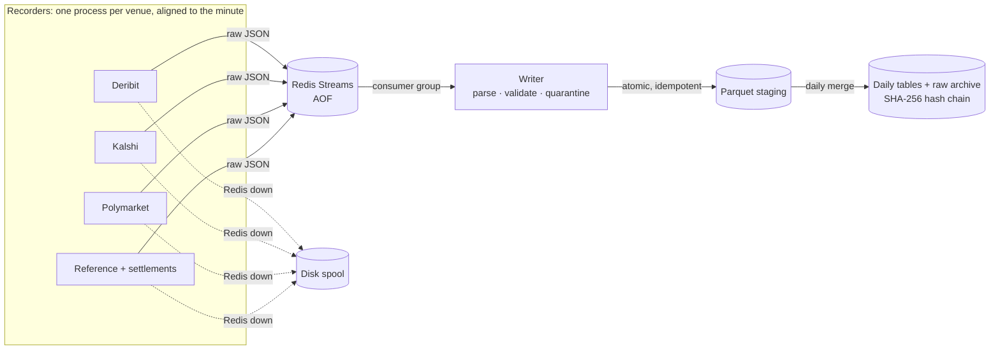

# implied-odds

**Do prediction markets price Bitcoin the same way the options market does?**

A Kalshi or Polymarket contract like *"BTC above $95,000 at 5 pm ET"* is a digital option. This project
records prediction markets and Deribit's BTC/ETH options side by side, every minute, to compare the
probabilities each market implies. The pricing side uses an arbitrage-free SSVI volatility surface
with a skew-corrected digital pricer (C++ core, in development).

## Highlights

- **Fault-tolerant market-data pipeline.** Five recorder processes (Deribit, Kalshi, Polymarket, reference
  prices, settlements) → Redis Streams → Parquet. At-least-once delivery plus idempotent, atomic writes:
  after SIGKILLing the writer mid-run, Docker restarted it in **0.9 s** and all **146/146** messages were written exactly once.
- **Tamper-evident dataset.** Each day is compacted into one file per table and recorded in a SHA-256
  **hash chain**. `ppm verify` recomputes it in **0.28 s** and catches modified, deleted, swapped, inserted
  or forged files. Corrections are appended, never rewritten.
- **Compaction:** 16 h of data went from 21,949 small files to **13 files** at half the bytes; 505k option rows fit in 7.8 MB.
- **Real settlement data.** Collects Kalshi's actual BRTI settlement values and Polymarket resolutions. A test
  replays a real day: all 22 resolved Polymarket contracts match the Binance noon close under our bracket rules.
- **Schema-validated ingestion.** Explicit Arrow schemas, with bad rows quarantined instead of written.
  Parsers are pure functions tested against saved real API responses (0 rows quarantined in live runs).
- **Scale:** ~3,300 rows/min across venues, fetched concurrently; Deribit's 6 calls per snapshot land within 11–65 ms of each other.

## Architecture



| Failure | Handling |
|---|---|
| Writer crashes mid-batch | Ack only after data is on disk; unacked messages are redelivered on restart |
| Message delivered twice | File names derive from (tick, venue, request), so a replay overwrites the identical file |
| Redis unreachable | Recorders spool to disk (bounded) and replay in order |
| A venue's API changes | Only that venue's process is affected; bad rows are quarantined with a reason |
| Past data edited or deleted | Hash-chain verification fails loudly |
| A venue goes silent or only returns errors | `ppm monitor` alerts once (log + optional phone push), once on recovery, and logs every missing tick live |

Design decisions and trade-offs: [`docs/design/recorder-pipeline.md`](docs/design/recorder-pipeline.md).

## Stack

Python 3.11 (asyncio, httpx, redis-py, pyarrow) · C++20 with pybind11 (CMake, GoogleTest, Google Benchmark) ·
Redis Streams · Parquet · Docker multi-stage + Compose · Terraform (AWS Lightsail VM + S3 backup bucket; [design](docs/design/cloud-vm.md)) ·
GitHub Actions CI (Ubuntu, macOS, Docker build) · uv · ruff

## Run it

```bash
uv sync && uv run pytest          # tests (builds the C++ extension too)
docker compose up -d --build      # Redis + writer + all recorders + daily merger, auto-restarting
uv run ppm verify                 # check the dataset's hash chain
```

Public market data only; no API keys needed. Research and paper trading only; never places orders.
