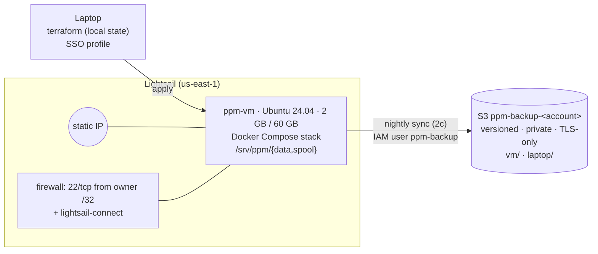

# Cloud VM and off-machine backup (Phase 0, Stage 2)

Status: **2a built and tested 2026-11-13** (Terraform base: VM, firewall, S3 bucket, IAM user).
2b–2d (deploy, nightly backup, 24 h parallel run) are designed below but not built yet.

## 1. Problem and "done"

Recording ran on a laptop that has to stay plugged in with the lid open. Sleep still causes
gaps: one night recorded 91 of ~723 minutes; on 2026-11-13 a 15-tick reference gap and a
recorder that woke 14 h late. The dataset's hash chain is also only as trustworthy as the
place its head is stored, and so far that was the same disk as the data.

Done (whole stage): the Compose stack runs on a small cloud VM, created by Terraform;
every merged day and the chain head are copied nightly to S3, where the VM can add but
never delete; coverage on the VM is measured against the laptop before the laptop stops.

| Step | What | Proven by |
|---|---|---|
| **2a** | Terraform: VM, static IP, firewall, S3 bucket, scoped IAM user | clean `plan` after `apply`, on-VM checks, IAM policy simulation, anonymous access refused |
| 2b | Deploy the Compose stack (incl. monitor) on the VM | `ppm faulttest` passes on the VM |
| 2c | Nightly S3 sync + head recorded off-machine | truncate manifest → `ppm verify --expect-head <S3 head>` fails; restore from S3 → `verify` passes |
| 2d | 24 h laptop + VM in parallel | per-venue coverage numbers; VM becomes canonical; monthly cost recorded |

## 2. Architecture

Terraform lives in `infra/terraform/` as one flat root module (one VM, one owner; child
modules would be speculative):

| File | Contents |
|---|---|
| `versions.tf` | Terraform ≥ 1.9, `hashicorp/aws ~> 6.70` (exact build pinned in the committed `.terraform.lock.hcl`) |
| `providers.tf` | region, SSO profile, `default_tags` |
| `variables.tf` | `admin_cidr` (validated /32), key path, bundle |
| `lightsail.tf` | key pair (public half only), instance, static IP + attachment, firewall |
| `s3.tf` | bucket + public-access block, ownership, versioning, SSE-S3, lifecycle, TLS-only policy |
| `iam.tf` | `ppm-backup` user + inline policy |
| `cloud-init.sh` | first-boot script: Docker CE + Compose, 2 GB swap, data dirs (uid 1000), auto security updates |

State is local and git-ignored. `terraform.tfvars` (the owner's IP) is git-ignored.

## 3. Decisions

| Decision | Alternatives | Why |
|---|---|---|
| Lightsail `small_3_0` (2 GB, 2 vCPU, 60 GB, 3 TB, 1 IPv4) at $12/month | EC2 t3.small (+ EBS + IPv4 ≈ $23/month); laptop + cron | Flat, predictable price; the whole stack uses < 1 GB RAM |
| IAM **user** for the backup; the access key is created by hand, outside Terraform, and stored only on the VM | `aws_iam_access_key` in Terraform; Lightsail object storage; EC2 + instance role | Lightsail instances can't take an IAM role, so a long-lived key is unavoidable; Terraform state is plaintext, so the secret stays out of it |
| Tamper protection = versioning + a key that can't delete | S3 Object Lock (governance) | An overwrite keeps the old version, so a recorded head can always be recovered. The threat model is bugs and accidents, not a determined attacker |
| SSH only from the owner's /32, plus Lightsail's browser SSH (`lightsail-connect`) | Tailscale; port 22 open to all | Minimal exposure, no extra service, never locked out when the home IP changes |
| `prevent_destroy` on the VM and bucket; `ignore_changes = [user_data, blueprint_id]` | Let Terraform replace freely | Editing the boot script would otherwise destroy the VM and any data not yet backed up |
| Code reaches the VM by `git clone` + `docker compose up --build` (2b) | Build in CI, push to a registry | One VM; fewer moving parts |

## 4. Security model

- **Network:** the firewall resource replaces Lightsail's defaults (22 and 80 open to the
  world) with one rule. Redis binds to 127.0.0.1 in Compose, so nothing else is reachable.
- **Identity:** Terraform runs as the owner's IAM Identity Center (SSO) session; there are
  no long-lived admin keys anywhere. The VM's only AWS identity is `ppm-backup`:
  - allowed: `ListBucket` with prefix `vm/`; `PutObject`, `GetObject`, `AbortMultipartUpload` on `vm/*`
  - implicitly denied: everything else, including the `laptop/` prefix
  - **explicitly denied** (wins over any future Allow): `DeleteObject`, `DeleteObjectVersion`,
    `DeleteBucket`, `PutBucketVersioning`, `PutLifecycleConfiguration`, `Put/DeleteBucketPolicy`,
    `PutBucketPublicAccessBlock`
- **Bucket:** all four public-access blocks on, ACLs disabled (`BucketOwnerEnforced`),
  SSE-S3 encryption, and a policy denying any request not made over TLS.
- **Host identity:** the VM's SSH host-key fingerprints are checked against
  `aws lightsail get-instance-access-details` before the first login, not accepted blindly.

## 5. Cost (2026-11-13, us-east-1)

| Item | Monthly |
|---|---|
| Lightsail `small_3_0` (static IP free while attached) | $12.00 |
| S3 Standard at $0.023/GB-month; data grows ~12.6 GB/month (~420 MB/day merged) | ~$0.30 in month 1, +~$0.30 each month |
| Requests (a few hundred PUTs per night) | < $0.01 |

Account budget alarm: $20/month.

## 6. What went wrong (2a)

The first `apply` booted a VM with no Docker, swap or data directories, and
`cloud-init status` reported `error`. `/var/log/cloud-init-output.log` showed
`part-001: 22: set: Illegal option -o pipefail`. **Lightsail prepends its own `#!/bin/sh`
launch script** (it installs the SSH CA used by browser SSH), so our `#!/bin/bash` line
became a comment and the whole file ran under dash, which has no `pipefail`. Fix: the
script is POSIX `sh`, checked with `shellcheck -s sh` and `dash -n`. The same log showed
Lightsail's part running `service sshd restart`, which fails on Ubuntu 24.04 (the unit is
`ssh`), so the browser-SSH CA wasn't loaded; our script now restarts `ssh` itself.

Rebuilding the VM to re-run the script exposed a second trap: `-replace` on the instance
alone left the firewall and static-IP attachment "unchanged" in the plan, because they
refer to the VM by name and the name doesn't change. A new instance gets Lightsail's
default firewall, and deleting the old one detaches the IP. All three were replaced
together.

## 7. Risks

- **Disk:** 60 GB holds about 140 days at the current rate. Needs either local retention
  after a verified S3 copy, or a Lightsail block-storage disk, before ~2027-03.
- **Local Terraform state:** if the laptop is lost, the resources keep running but must be
  re-imported (`terraform import`). Acceptable for one owner; remote state in S3 is the upgrade.
- **Long-lived backup key:** rotate by hand (create a new key, swap it on the VM, delete the old one).
