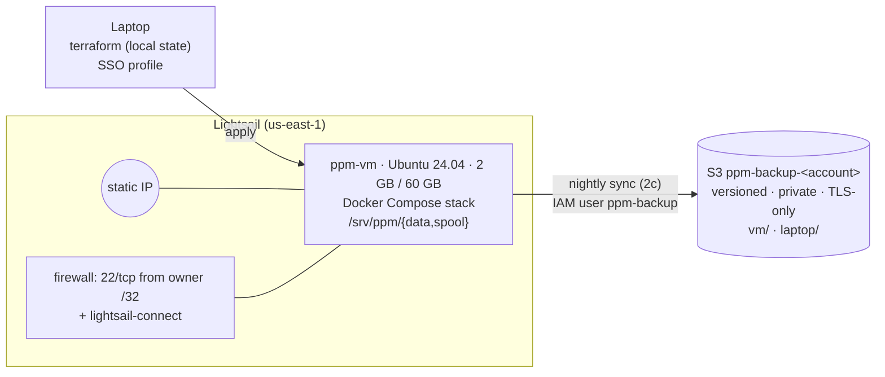
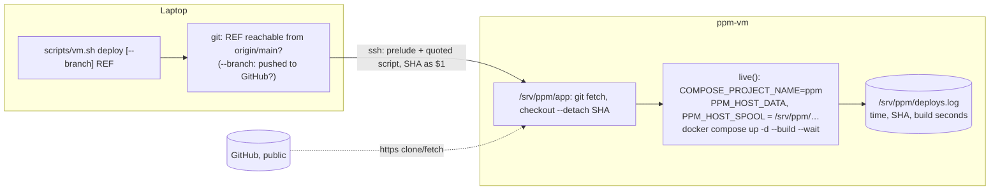
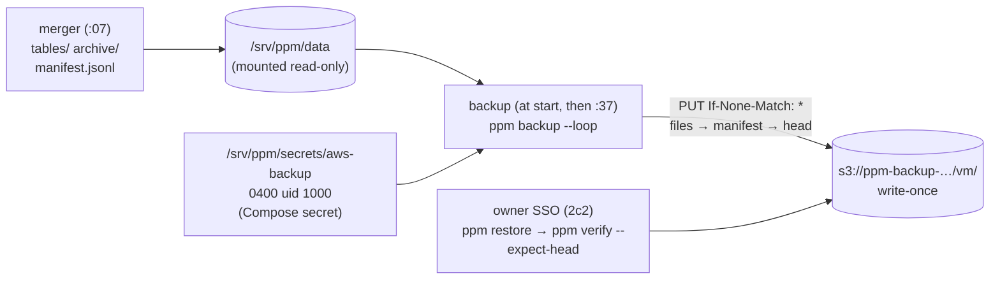

# Cloud VM and off-machine backup (Phase 0, Stage 2)

Status: **2a built and tested 2026-11-13** (Terraform base: VM, firewall, S3 bucket, IAM user).
**2b deployed and tested 2026-11-14** (Compose stack running on the VM; `ppm faulttest` passes
there; see §8). **2c1 deployed 2026-11-14** (write-once S3 backup service; the permission
check passes against real S3; the first data upload waits for the VM's first merge; see §9).
2c2 and 2d are not built yet.

## 1. Problem and "done"

Recording ran on a laptop that has to stay plugged in with the lid open. Sleep still causes
gaps: one night recorded 91 of ~723 minutes; on 2026-11-13 a 15-tick reference gap and a
recorder that woke 14 h late. The dataset's hash chain is also only as trustworthy as the
place its head is stored, and so far that was the same disk as the data.

Done (whole stage): the Compose stack runs on a small cloud VM, created by Terraform;
every merged day and the chain head are copied nightly to S3, where the VM can add but
never delete; coverage on the VM is measured against the laptop before the laptop stops.

| Step | What | Proven by |
|---|---|---|
| **2a** | Terraform: VM, static IP, firewall, S3 bucket, scoped IAM user | clean `plan` after `apply`, on-VM checks, IAM policy simulation, anonymous access refused |
| **2b** | Deploy the Compose stack (incl. monitor) on the VM | `ppm faulttest` passes on the VM, next to the live stack |
| **2c1** | Write-once S3 backup service + bucket policy | unit tests; VM-key probes: overwrite → 412; unconditional PUT, If-Match, DELETE, write outside `vm/` → 403 |
| 2c2 | Restore + tamper tests (owner's SSO session) | truncate manifest → `ppm verify --expect-head <S3 head>` fails; restore from S3 → `verify` passes; 1 version per key |
| 2d | 24 h laptop + VM in parallel | per-venue coverage numbers; VM becomes canonical; monthly cost recorded |

## 2. Architecture



Terraform lives in `infra/terraform/` as one flat root module (one VM, one owner; child
modules would be speculative):

| File | Contents |
|---|---|
| `versions.tf` | Terraform ≥ 1.9, `hashicorp/aws ~> 6.70` (exact build pinned in the committed `.terraform.lock.hcl`) |
| `providers.tf` | region, SSO profile, `default_tags` |
| `variables.tf` | `admin_cidr` (validated /32), key path, bundle |
| `lightsail.tf` | key pair (public half only), instance, static IP + attachment, firewall |
| `s3.tf` | bucket + public-access block, ownership, versioning, SSE-S3, lifecycle, TLS-only policy |
| `iam.tf` | `ppm-backup` user + inline policy |
| `cloud-init.sh` | first-boot script: Docker CE + Compose, 2 GB swap, data dirs (uid 1000), auto security updates |

State is local and git-ignored. `terraform.tfvars` (the owner's IP) is git-ignored.

## 3. Decisions

| Decision | Alternatives | Why |
|---|---|---|
| Lightsail `small_3_0` (2 GB, 2 vCPU, 60 GB, 3 TB, 1 IPv4) at $12/month | EC2 t3.small (+ EBS + IPv4 ≈ $23/month); laptop + cron | Flat, predictable price; the whole stack uses < 1 GB RAM |
| IAM **user** for the backup; the access key is created by hand, outside Terraform, and stored only on the VM | `aws_iam_access_key` in Terraform; Lightsail object storage; EC2 + instance role | Lightsail instances can't take an IAM role, so a long-lived key is unavoidable; Terraform state is plaintext, so the secret stays out of it |
| Tamper protection = versioning + a key that can't delete | S3 Object Lock (governance) | An overwrite keeps the old version, so a recorded head can always be recovered. The threat model is bugs and accidents, not a determined attacker |
| SSH only from the owner's /32, plus Lightsail's browser SSH (`lightsail-connect`) | Tailscale; port 22 open to all | Minimal exposure, no extra service, never locked out when the home IP changes |
| `prevent_destroy` on the VM and bucket; `ignore_changes = [user_data, blueprint_id]` | Let Terraform replace freely | Editing the boot script would otherwise destroy the VM and any data not yet backed up |
| Code reaches the VM by `git clone` + `docker compose up --build` (2b) | Build in CI, push to a registry | One VM; fewer moving parts |

## 4. Security model

- **Network:** the firewall resource replaces Lightsail's defaults (22 and 80 open to the
  world) with one rule. Redis binds to 127.0.0.1 in Compose, so nothing else is reachable.
- **Identity:** Terraform runs as the owner's IAM Identity Center (SSO) session; there are
  no long-lived admin keys anywhere. The VM's only AWS identity is `ppm-backup`:
  - allowed: `ListBucket` with prefix `vm/`; `PutObject`, `GetObject`, `AbortMultipartUpload` on `vm/*`
  - implicitly denied: everything else, including the `laptop/` prefix
  - **explicitly denied** (wins over any future Allow): `DeleteObject`, `DeleteObjectVersion`,
    `DeleteBucket`, `PutBucketVersioning`, `PutLifecycleConfiguration`, `Put/DeleteBucketPolicy`,
    `PutBucketPublicAccessBlock`
- **Bucket:** all four public-access blocks on, ACLs disabled (`BucketOwnerEnforced`),
  SSE-S3 encryption, and a policy denying any request not made over TLS.
- **Host identity:** the VM's SSH host-key fingerprints are checked against
  `aws lightsail get-instance-access-details` before the first login, not accepted blindly.

## 5. Cost (2026-11-13, us-east-1)

| Item | Monthly |
|---|---|
| Lightsail `small_3_0` (static IP free while attached) | $12.00 |
| S3 Standard at $0.023/GB-month; data grows ~12.6 GB/month (~420 MB/day merged) | ~$0.30 in month 1, +~$0.30 each month |
| Requests (a few hundred PUTs per night) | < $0.01 |

Account budget alarm: $20/month.

## 6. What went wrong (2a)

The first `apply` booted a VM with no Docker, swap or data directories, and
`cloud-init status` reported `error`. `/var/log/cloud-init-output.log` showed
`part-001: 22: set: Illegal option -o pipefail`. **Lightsail prepends its own `#!/bin/sh`
launch script** (it installs the SSH CA used by browser SSH), so our `#!/bin/bash` line
became a comment and the whole file ran under dash, which has no `pipefail`. Fix: the
script is POSIX `sh`, checked with `shellcheck -s sh` and `dash -n`. The same log showed
Lightsail's part running `service sshd restart`, which fails on Ubuntu 24.04 (the unit is
`ssh`), so the browser-SSH CA wasn't loaded; our script now restarts `ssh` itself.

Rebuilding the VM to re-run the script exposed a second trap: `-replace` on the instance
alone left the firewall and static-IP attachment "unchanged" in the plan, because they
refer to the VM by name and the name doesn't change. A new instance gets Lightsail's
default firewall, and deleting the old one detaches the IP. All three were replaced
together.

## 7. Risks

- **Disk:** 60 GB holds about 140 days at the current rate. Needs either local retention
  after a verified S3 copy, or a Lightsail block-storage disk, before ~2027-03.
- **Local Terraform state:** if the laptop is lost, the resources keep running but must be
  re-imported (`terraform import`). Acceptable for one owner; remote state in S3 is the upgrade.
- **Long-lived backup key:** rotate by hand (create a new key, swap it on the VM, delete the old one).

## 8. Stage 2b: deploying the stack (2026-11-14)

### How code and settings reach the VM



`scripts/vm.sh` is the only place the VM's settings live. Every VM-side script starts with a
shared prelude defining `live()`, so the project name and data paths can't be forgotten.
If `PPM_HOST_DATA` were missing, Compose would silently write into the checkout. If the
project name defaulted, it would come from the directory name and rename the Redis volume.
Script bodies are quoted heredocs (nothing expands on the laptop), and arguments must be
plain tokens, because SSH re-splits them on the VM.

| Command | Does |
|---|---|
| `bootstrap` | idempotent: `g++` (apt), uv 0.13.7 (pinned official installer), https clone to `/srv/ppm/app` |
| `deploy [--branch] [REF]` | refuses a SHA not on `origin/main` (or, with `--branch`, not pushed); checkout `--detach`; `up -d --build --wait`; appends to `deploys.log` |
| `status` | deployed SHA, services, `free -m`, disk, Redis memory + per-stream length/bytes, last monitor alerts |
| `logs SERVICE [ARGS]` | `docker compose logs` for the live project |
| `faulttest [ARGS]` | refuses 01:25–03:30 UTC (daily merge at 02:07); `uv sync --no-dev`, then `uv run --no-sync ppm faulttest` detached under `nohup`, with RAM/swap sampled every 10 s and per-container memory every 60 s |

`ppm faulttest` runs on the VM's **host**, not in a container. It drives the `docker` CLI
and reads the run's Parquet, exactly as on the laptop. It uses a uv-managed Python 3.11,
the same version as the image, which ships the headers `ppm_core` needs (Ubuntu's Python
3.12 has none). The rejected alternative was a harness container with `docker.sock`
mounted: that is root-equivalent, and the repo would have to be mounted at an identical
path, because Compose resolves bind mounts on the host.

### Redis memory: retention by time, not by count

The streams kept the last 20,000 messages each. Message sizes differ by venue (deribit
16 KB, kalshi 17 KB, settlements 33 KB, polymarket 5.5 KB), so at steady state Redis would
hold about 1.4 GB, which doesn't fit in 1.9 GB of RAM alongside eight Python services. The
cap is also the writer-downtime tolerance, because Redis trims unacknowledged entries too.
Under the count cap that tolerance ranged from 21 h (polymarket) to 16 days (settlements).

Now each publish runs `XADD`, then `XTRIM MINID <arrival ms − 12 h>`. A stream ID is
`<ms>-<seq>` stamped by Redis, so this keeps exactly the last 12 h on every stream (about
205 MB). The cutoff comes from the ID Redis just returned, not the recorder's clock, so
clock skew between the two can't trim new messages. Docker Desktop's VM clock drifts after
the Mac sleeps. Trimming is exact (not `~`), and a failed trim doesn't re-spool an
already-stored message. Setting: `PPM_STREAM_RETAIN_H`, passed into every ppm container
by `docker-compose.yml`. Rejected: a VM-only cap of 4000
(about 290 MB, but only about 4 h of tolerance for polymarket); resizing to 4 GB ($24/month,
forces a replacement).

### Results (2026-11-14, deploy `867e4a8`)

| Check | Result |
|---|---|
| bootstrap | 22 s; second run changes nothing |
| first deploy (image build incl. C++ + start) | 94 s; 9/9 services up |
| `ppm faulttest` next to the live stack | writer-kill, recorder-kill, recorder-stop, redis-outage, net-cut, monitor, integrity **all PASS**; sent 811 = delivered 811 = stored 811, 0 lost, 0 duplicated |
| live stack during the test | 0 monitor ALERT/GAP lines, 0 writer errors, 0 container restarts |
| memory, whole VM | before the test 983 MB used; **peak 1234 MB used + 286 MB swap** (of 1905 MB + 2 GB swap); live containers peaked at 428 MiB total |
| reboot (`systemctl reboot`) | all 9 services running again after **28 s**, via `restart: unless-stopped`; 0 ticks missed (reboot at :16 s, back before the next tick) |
| refusals | unmerged SHA, unpushed SHA with `--branch`, faulttest at 02:07 UTC, argument with shell characters: all exit 1, nothing run |

The VM numbers match the laptop's (silent ALERT 150.9 s after the last tick vs 151.2 s;
Redis ALERT 64.3 s vs 64.6 s; `failing` ALERT 231.4 s vs 231.5 s).

### What went wrong

- **`MAXLEN`'s byte cost was invisible until measured.** The cap was chosen as "about 2 days
  of deribit". Per-stream `MEMORY USAGE` on the laptop showed settlements at 33 KB per
  message heading for 660 MB on its own.
- **Approximate trimming never trimmed in tests.** `MINID ~` only drops whole internal
  nodes (about 100 entries), so a small test stream stayed untouched. Exact trimming costs
  nothing at about 30 messages a minute, and tests now exercise what production runs.
- **First draft trimmed by the recorder's clock.** Caught before deploying: on the laptop,
  Redis runs in Docker Desktop's VM, whose clock can lag. A cutoff ahead of Redis would trim
  brand-new messages. Fixed by measuring from the returned ID.
- **`nohup cmd | tee` doesn't survive a dropped SSH session.** `tee` dies with the session
  and the test then gets a broken pipe. Now the test writes to a file, the session only
  `tail --pid`s it, and the samplers run only while the test's PID is alive.
- **`uv run` re-synced the dev group** (pytest, ruff, fakeredis) right after
  `uv sync --no-dev`. Harmless, but not what the script claimed. Fixed with `uv run --no-sync`
  (after the measured run; same code under test).
- **Diff review found `status` silently stopping halfway.** `bash -s` reads its script
  from stdin, and `docker compose exec` (even with `-T`) read the rest of it, so the monitor
  section never ran, yet the command still exited 0. Every stdin-reading VM command now gets
  `</dev/null`. The same review found that `PPM_STREAM_RETAIN_H` never reached the
  containers (now passed by Compose), and that `deploy --branch` trusted stale
  remote-tracking refs (now `fetch --prune`).

### Open risks after 2b

- **A dead writer isn't alerted, and the loss would be silent.** `ppm monitor` watches
  venue streams, not the writer. After 12 h, messages the writer never received are trimmed
  with no `DATA LOSS` line (that line covers only delivered-but-unacked ones). A writer-lag
  alert is designed (`recorder-pipeline.md` §5) but not built. It should exist before the
  VM becomes canonical (2d).
- **Memory headroom is about 650 MB** with both stacks plus some swap. The daily merge (peak
  396 MB on 16 h of data in testing; a full day is bigger) must not overlap a fault test,
  hence the 01:25–03:30 refusal. Check the merge's real peak on the VM in 2d.

## 9. Stage 2c1: write-once S3 backup (2026-11-14)

**Problem.** The data and its chain head sat on one disk. A truncated `manifest.jsonl`
is still a valid chain, so `ppm verify` passes unless it's given a head recorded
somewhere the VM can't rewrite.

**Done (2c1):** a service on the VM copies every merged file, the manifest and the head
to S3. The VM's key can create objects under `vm/` but never replace or delete one,
proven against real S3. In 2c2, the owner's SSO session restores from S3 and runs the
tamper test.

### Design (decided 2026-11-14)



| Decision | Alternatives | Why |
|---|---|---|
| Compose service `backup`, catch-up pass at start and hourly at :37, `profiles: [backup]` | Host systemd timer + AWS CLI script; a timer that launches a one-shot container | One deploy path, with the same restart and logging as the merger. The logic is Python and unit-tested. A late merge or an outage is caught up on the next pass instead of the next night |
| Key piped from `aws iam create-access-key` into `vm.sh backup-key` | Paste it over SSH; SSM Parameter Store | The secret only travels through pipes. SSM would need a credential to fetch the credential |
| **Write-once keys**, enforced by the bucket policy: `s3:if-none-match` must be present and `s3:if-match` absent | Overwrite + versioning with a "first version wins" check; the laptop records heads; S3 Object Lock | The VM *cannot* overwrite, so every key has exactly one version. Object Lock only prevents deleting versions, which the deny-delete policy already does |

**S3 layout** (every key is created once):

```
vm/<entry.path>               each merged file (tables/…/part-N.parquet, archive/…/raw-N.tar)
vm/manifest/000025.jsonl      the manifest when its last entry had seq 25
vm/heads/000025.json          {"head": <chain>, "manifest_sha256": …, "seq": 25}
vm/probe/<timestamp>.txt      left by `ppm backup --check-permissions`
```

**One pass** (`python/ppm/backup/job.py`):
1. Snapshot the manifest (complete lines only) and check its chain.
2. The local chain must **extend** the newest stored head, meaning the same chain value at
   that seq. If it doesn't, the pass stops with `fork`.
3. Re-hash each new entry's file against the manifest, then upload it. A HEAD request
   comes first, so a crashed pass never re-sends a 400 MB tar.
4. Upload the manifest snapshot, then the head, **last**.

A refused pass (`fork`, `integrity`) or an S3 error logs `ALERT kind=backup` and is
pushed via ntfy once per distinct problem; `RECOVERED` follows when a pass succeeds again.

**Policy details**
- CreateMultipartUpload and UploadPart can't carry `If-None-Match`, so the Deny exempts
  them (`s3:ObjectCreationOperation = false`). The condition is checked on
  CompleteMultipartUpload, the moment the object appears.
- The Deny sits in the **bucket** policy, so widening the user's own policy later can't
  undo it.
- Side effect: no CopyObject into `vm/`.

### Results (2026-11-14, deploy `4d8a971`)

- `terraform apply`: only the bucket policy changed; the `plan` afterwards is clean.
- **`vm.sh backup-check`, VM key against real S3: 6/6 PASS.**

  | Request | Expected |
  |---|---|
  | create a new key | 200 |
  | re-create it | 412 |
  | PUT without `If-None-Match` | 403 |
  | `If-Match` overwrite | 403 |
  | DELETE | 403 |
  | write outside `vm/` | 403 |

- Key installed: `aws-backup` is mode 400, uid 1000, 116 bytes; its directory is 0700. The
  failure path (bad JSON piped in) wrote nothing and exited 1.
- Deploy: 81 s build+start, **0 ticks missed** (every venue present every minute
  03:06–03:10). That was timing luck, not design; 2e is still needed.
- Idle RAM of `backup`: **105 MiB** (estimate was 60–80). VM memory available after the
  deploy: 836 MB.
- Image size: 454 → 510 MB (+56 MB for boto3/botocore; estimate was ~15 MB).
- **Pending:** the first real upload. The VM's first merge is 2026-11-15 ~02:07 UTC, so
  the first pass with data is at 02:37. Record its time and bytes, and how long a pass with
  nothing new takes.

### What went wrong

- **boto3's managed `upload_file` silently drops `IfNoneMatch`.** In s3transfer 0.19.3 it
  is in neither `ALLOWED_UPLOAD_ARGS` nor the complete-multipart args. Using it would have
  turned every write-once upload into an unconditional PUT, which the policy denies.
  - Fix: `put_object` up to 64 MB; above that, our own sequential multipart upload
    (16 MB parts) with the condition on `complete_multipart_upload`.
- **The first draft re-sent whole files after a crash** only to get a 412 back. A unit
  test exposed it; the job now sends a HEAD request first.
- **"Also once at start" was false for :37.** The comment was copied from the merger's :07
  loop. After the 03:08 deploy, the first pass would have waited until 03:37.
  - Fix (after the deploy): the first pass now runs at startup.
- **The data-protection hook blocked two shell commands,** because their text contained
  `rm`/`mv` next to `data`. Used the Edit tool and a commit-message file instead, as the
  project notes say.

### Diff review (subagent, 2026-11-14)

**Disproved by a live test**
- *"HEAD on a missing key returns 403, so every pass fails."* The claim was that the
  ListBucket grant's `s3:prefix` condition doesn't apply to HEAD. From the VM's container,
  HEAD `vm/does-not-exist.txt` returned **404**. It is now a 7th probe in
  `--check-permissions`, so the claim is re-proven on every check.

**Fixed (each with a unit test)**
- An emptied or missing manifest, or an empty `/data` mount, after a backup logged
  "nothing new". It is now a `fork`.
- After the startup pass, the next :37 was skipped (`next_tick` + offset). Fixed with
  `next_backup_at`.
- De-duplication compared the full error text, which includes request IDs, so one S3
  outage would push every hour. S3/network errors now compare by exception type.
- With the key installed but the bucket file missing, the service crash-looped with no
  alert. `live()` now enables the profile only when both files exist.

**Accepted**
- A 409 `ConditionalRequestConflict` (two writers racing on one key) isn't mapped to
  "exists". The upload is aborted and retried next pass. There is only one writer.

### Open risks after 2c1

- **A VM that silently stops backing up isn't caught off-machine.** The service alerts on
  its own failures, but if it stops entirely, only the age of the newest `vm/heads/` key
  shows it. 2c2's check, or a later laptop-side check, should flag a head older than ~26 h.
- **Probe objects pile up:** each `backup-check` run leaves ~20 bytes the VM can't delete.
  Negligible; the owner can delete `vm/probe/` by hand.
- **Key rotation is manual:** create a second key, run `vm.sh backup-key`, redeploy, then
  delete the old key.
