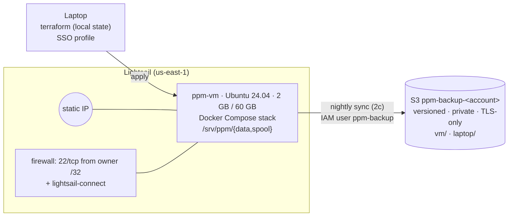
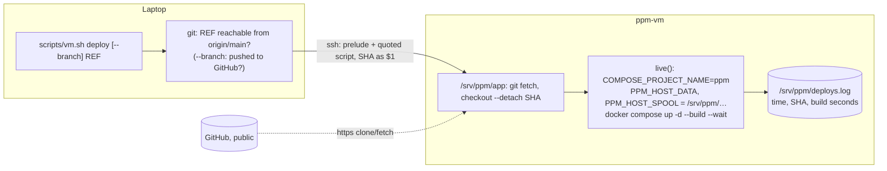
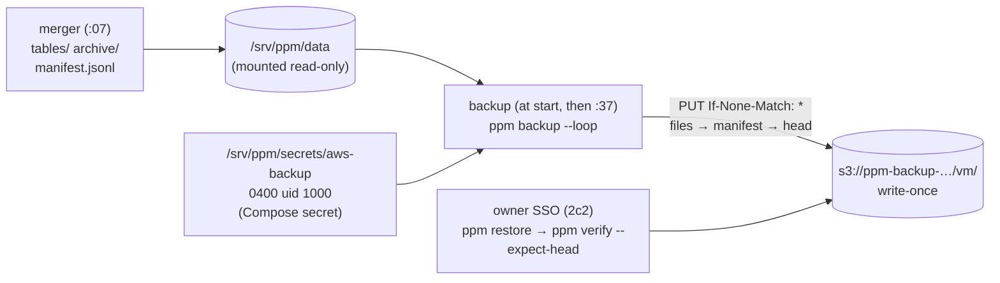

# Cloud VM and off-machine backup (Phase 0, Stage 2)

Status: **2a built and tested 2026-11-13** (Terraform base: VM, firewall, S3 bucket, IAM user).
**2b deployed and tested 2026-11-14** (Compose stack running on the VM; `ppm faulttest` passes
there; see §8). **2c1 deployed 2026-11-14** (write-once S3 backup service; the permission
check passes against real S3); **first real upload 2026-11-15** (491.0 MB in 13.1 s; see §9).
**2c2 tested 2026-11-15** (restore + tamper; §10). **2e deployed and tested 2026-11-15**
(tick-aligned deploy, 0 ticks lost in 4 deploys; §11). **2f built and tested 2026-11-15**
(`ppm backup --status`, owner SSO, on demand; §12). 2d is not built yet.

## 1. Problem and "done"

Recording ran on a laptop that has to stay plugged in with the lid open. Sleep still causes
gaps: one night recorded 91 of ~723 minutes; on 2026-11-13 a 15-tick reference gap and a
recorder that woke 14 h late. The dataset's hash chain is also only as trustworthy as the
place its head is stored, and so far that was the same disk as the data.

Done (whole stage): the Compose stack runs on a small cloud VM, created by Terraform;
every merged day and the chain head are copied nightly to S3, where the VM can add but
never delete; coverage on the VM is measured against the laptop before the laptop stops.

| Step | What | Proven by |
|---|---|---|
| **2a** | Terraform: VM, static IP, firewall, S3 bucket, scoped IAM user | clean `plan` after `apply`, on-VM checks, IAM policy simulation, anonymous access refused |
| **2b** | Deploy the Compose stack (incl. monitor) on the VM | `ppm faulttest` passes on the VM, next to the live stack |
| **2c1** | Write-once S3 backup service + bucket policy | unit tests; VM-key probes: overwrite → 412; unconditional PUT, If-Match, DELETE, write outside `vm/` → 403 |
| 2c2 | Restore + tamper tests (owner's SSO session) | truncate manifest → `ppm verify --expect-head <S3 head>` fails; restore from S3 → `verify` passes; 1 version per key |
| 2d | 24 h laptop + VM in parallel | per-venue coverage numbers; VM becomes canonical; monthly cost recorded |

## 2. Architecture



Terraform lives in `infra/terraform/` as one flat root module (one VM, one owner; child
modules would be speculative):

| File | Contents |
|---|---|
| `versions.tf` | Terraform ≥ 1.9, `hashicorp/aws ~> 6.70` (exact build pinned in the committed `.terraform.lock.hcl`) |
| `providers.tf` | region, SSO profile, `default_tags` |
| `variables.tf` | `admin_cidr` (validated /32), key path, bundle |
| `lightsail.tf` | key pair (public half only), instance, static IP + attachment, firewall |
| `s3.tf` | bucket + public-access block, ownership, versioning, SSE-S3, lifecycle, TLS-only policy |
| `iam.tf` | `ppm-backup` user + inline policy |
| `cloud-init.sh` | first-boot script: Docker CE + Compose, 2 GB swap, data dirs (uid 1000), auto security updates |

State is local and git-ignored. `terraform.tfvars` (the owner's IP) is git-ignored.

## 3. Decisions

| Decision | Alternatives | Why |
|---|---|---|
| Lightsail `small_3_0` (2 GB, 2 vCPU, 60 GB, 3 TB, 1 IPv4) at $12/month | EC2 t3.small (+ EBS + IPv4 ≈ $23/month); laptop + cron | Flat, predictable price; the whole stack uses < 1 GB RAM |
| IAM **user** for the backup; the access key is created by hand, outside Terraform, and stored only on the VM | `aws_iam_access_key` in Terraform; Lightsail object storage; EC2 + instance role | Lightsail instances can't take an IAM role, so a long-lived key is unavoidable; Terraform state is plaintext, so the secret stays out of it |
| Tamper protection = versioning + a key that can't delete | S3 Object Lock (governance) | An overwrite keeps the old version, so a recorded head can always be recovered. The threat model is bugs and accidents, not a determined attacker |
| SSH only from the owner's /32, plus Lightsail's browser SSH (`lightsail-connect`) | Tailscale; port 22 open to all | Minimal exposure, no extra service, never locked out when the home IP changes |
| `prevent_destroy` on the VM and bucket; `ignore_changes = [user_data, blueprint_id]` | Let Terraform replace freely | Editing the boot script would otherwise destroy the VM and any data not yet backed up |
| Code reaches the VM by `git clone` + `docker compose up --build` (2b) | Build in CI, push to a registry | One VM; fewer moving parts |

## 4. Security model

- **Network:** the firewall resource replaces Lightsail's defaults (22 and 80 open to the
  world) with one rule. Redis binds to 127.0.0.1 in Compose, so nothing else is reachable.
- **Identity:** Terraform runs as the owner's IAM Identity Center (SSO) session; there are
  no long-lived admin keys anywhere. The VM's only AWS identity is `ppm-backup`:
  - allowed: `ListBucket` with prefix `vm/`; `PutObject`, `GetObject`, `AbortMultipartUpload` on `vm/*`
  - implicitly denied: everything else, including the `laptop/` prefix
  - **explicitly denied** (wins over any future Allow): `DeleteObject`, `DeleteObjectVersion`,
    `DeleteBucket`, `PutBucketVersioning`, `PutLifecycleConfiguration`, `Put/DeleteBucketPolicy`,
    `PutBucketPublicAccessBlock`
- **Bucket:** all four public-access blocks on, ACLs disabled (`BucketOwnerEnforced`),
  SSE-S3 encryption, and a policy denying any request not made over TLS.
- **Host identity:** the VM's SSH host-key fingerprints are checked against
  `aws lightsail get-instance-access-details` before the first login, not accepted blindly.

## 5. Cost (2026-11-13, us-east-1)

| Item | Monthly |
|---|---|
| Lightsail `small_3_0` (static IP free while attached) | $12.00 |
| S3 Standard at $0.023/GB-month; data grows ~12.6 GB/month (~420 MB/day merged) | ~$0.30 in month 1, +~$0.30 each month |
| Requests (a few hundred PUTs per night) | < $0.01 |

Account budget alarm: $20/month.

## 6. What went wrong (2a)

The first `apply` booted a VM with no Docker, swap or data directories, and
`cloud-init status` reported `error`. `/var/log/cloud-init-output.log` showed
`part-001: 22: set: Illegal option -o pipefail`. **Lightsail prepends its own `#!/bin/sh`
launch script** (it installs the SSH CA used by browser SSH), so our `#!/bin/bash` line
became a comment and the whole file ran under dash, which has no `pipefail`. Fix: the
script is POSIX `sh`, checked with `shellcheck -s sh` and `dash -n`. The same log showed
Lightsail's part running `service sshd restart`, which fails on Ubuntu 24.04 (the unit is
`ssh`), so the browser-SSH CA wasn't loaded; our script now restarts `ssh` itself.

Rebuilding the VM to re-run the script exposed a second trap: `-replace` on the instance
alone left the firewall and static-IP attachment "unchanged" in the plan, because they
refer to the VM by name and the name doesn't change. A new instance gets Lightsail's
default firewall, and deleting the old one detaches the IP. All three were replaced
together.

## 7. Risks

- **Disk:** 60 GB holds about 140 days at the current rate. Needs either local retention
  after a verified S3 copy, or a Lightsail block-storage disk, before ~2027-03.
- **Local Terraform state:** if the laptop is lost, the resources keep running but must be
  re-imported (`terraform import`). Acceptable for one owner; remote state in S3 is the upgrade.
- **Long-lived backup key:** rotate by hand (create a new key, swap it on the VM, delete the old one).

## 8. Stage 2b: deploying the stack (2026-11-14)

### How code and settings reach the VM



`scripts/vm.sh` is the only place the VM's settings live. Every VM-side script starts with a
shared prelude defining `live()`, so the project name and data paths can't be forgotten.
If `PPM_HOST_DATA` were missing, Compose would silently write into the checkout. If the
project name defaulted, it would come from the directory name and rename the Redis volume.
Script bodies are quoted heredocs (nothing expands on the laptop), and arguments must be
plain tokens, because SSH re-splits them on the VM.

| Command | Does |
|---|---|
| `bootstrap` | idempotent: `g++` (apt), uv 0.13.7 (pinned official installer), https clone to `/srv/ppm/app` |
| `deploy [--branch] [--recreate] [REF]` | refuses 01:55–03:30 UTC and a SHA not on `origin/main` (or, with `--branch`, not pushed); checkout `--detach`; `build` (fail → checkout restored, exit 1); wait for :10 past the minute; `up -d --wait --no-build`; tick check; appends to `deploys.log` (§11, 2e) |
| `status` | deployed SHA, services, `free -m`, disk, Redis memory + per-stream length/bytes, last monitor alerts |
| `logs SERVICE [ARGS]` | `docker compose logs` for the live project |
| `faulttest [ARGS]` | refuses 01:25–03:30 UTC (daily merge at 02:07); `uv sync --no-dev`, then `uv run --no-sync ppm faulttest` detached under `nohup`, with RAM/swap sampled every 10 s and per-container memory every 60 s |

`ppm faulttest` runs on the VM's **host**, not in a container. It drives the `docker` CLI
and reads the run's Parquet, exactly as on the laptop. It uses a uv-managed Python 3.11,
the same version as the image, which ships the headers `ppm_core` needs (Ubuntu's Python
3.12 has none). The rejected alternative was a harness container with `docker.sock`
mounted: that is root-equivalent, and the repo would have to be mounted at an identical
path, because Compose resolves bind mounts on the host.

### Redis memory: retention by time, not by count

The streams kept the last 20,000 messages each. Message sizes differ by venue (deribit
16 KB, kalshi 17 KB, settlements 33 KB, polymarket 5.5 KB), so at steady state Redis would
hold about 1.4 GB, which doesn't fit in 1.9 GB of RAM alongside eight Python services. The
cap is also the writer-downtime tolerance, because Redis trims unacknowledged entries too.
Under the count cap that tolerance ranged from 21 h (polymarket) to 16 days (settlements).

Now each publish runs `XADD`, then `XTRIM MINID <arrival ms − 12 h>`. A stream ID is
`<ms>-<seq>` stamped by Redis, so this keeps exactly the last 12 h on every stream (about
205 MB). The cutoff comes from the ID Redis just returned, not the recorder's clock, so
clock skew between the two can't trim new messages. Docker Desktop's VM clock drifts after
the Mac sleeps. Trimming is exact (not `~`), and a failed trim doesn't re-spool an
already-stored message. Setting: `PPM_STREAM_RETAIN_H`, passed into every ppm container
by `docker-compose.yml`. Rejected: a VM-only cap of 4000
(about 290 MB, but only about 4 h of tolerance for polymarket); resizing to 4 GB ($24/month,
forces a replacement).

### Results (2026-11-14, deploy `867e4a8`)

| Check | Result |
|---|---|
| bootstrap | 22 s; second run changes nothing |
| first deploy (image build incl. C++ + start) | 94 s; 9/9 services up |
| `ppm faulttest` next to the live stack | writer-kill, recorder-kill, recorder-stop, redis-outage, net-cut, monitor, integrity **all PASS**; sent 811 = delivered 811 = stored 811, 0 lost, 0 duplicated |
| live stack during the test | 0 monitor ALERT/GAP lines, 0 writer errors, 0 container restarts |
| memory, whole VM | before the test 983 MB used; **peak 1234 MB used + 286 MB swap** (of 1905 MB + 2 GB swap); live containers peaked at 428 MiB total |
| reboot (`systemctl reboot`) | all 9 services running again after **28 s**, via `restart: unless-stopped`; 0 ticks missed (reboot at :16 s, back before the next tick) |
| refusals | unmerged SHA, unpushed SHA with `--branch`, faulttest at 02:07 UTC, argument with shell characters: all exit 1, nothing run |

The VM numbers match the laptop's (silent ALERT 150.9 s after the last tick vs 151.2 s;
Redis ALERT 64.3 s vs 64.6 s; `failing` ALERT 231.4 s vs 231.5 s).

### What went wrong

- **`MAXLEN`'s byte cost was invisible until measured.** The cap was chosen as "about 2 days
  of deribit". Per-stream `MEMORY USAGE` on the laptop showed settlements at 33 KB per
  message heading for 660 MB on its own.
- **Approximate trimming never trimmed in tests.** `MINID ~` only drops whole internal
  nodes (about 100 entries), so a small test stream stayed untouched. Exact trimming costs
  nothing at about 30 messages a minute, and tests now exercise what production runs.
- **First draft trimmed by the recorder's clock.** Caught before deploying: on the laptop,
  Redis runs in Docker Desktop's VM, whose clock can lag. A cutoff ahead of Redis would trim
  brand-new messages. Fixed by measuring from the returned ID.
- **`nohup cmd | tee` doesn't survive a dropped SSH session.** `tee` dies with the session
  and the test then gets a broken pipe. Now the test writes to a file, the session only
  `tail --pid`s it, and the samplers run only while the test's PID is alive.
- **`uv run` re-synced the dev group** (pytest, ruff, fakeredis) right after
  `uv sync --no-dev`. Harmless, but not what the script claimed. Fixed with `uv run --no-sync`
  (after the measured run; same code under test).
- **Diff review found `status` silently stopping halfway.** `bash -s` reads its script
  from stdin, and `docker compose exec` (even with `-T`) read the rest of it, so the monitor
  section never ran, yet the command still exited 0. Every stdin-reading VM command now gets
  `</dev/null`. The same review found that `PPM_STREAM_RETAIN_H` never reached the
  containers (now passed by Compose), and that `deploy --branch` trusted stale
  remote-tracking refs (now `fetch --prune`).

### Open risks after 2b

- *(Closed 2026-11-15 by 2d2, §13.)* **A dead writer isn't alerted, and the loss would be silent.** `ppm monitor` watches
  venue streams, not the writer. After 12 h, messages the writer never received are trimmed
  with no `DATA LOSS` line (that line covers only delivered-but-unacked ones). A writer-lag
  alert is designed (`recorder-pipeline.md` §5) but not built. It should exist before the
  VM becomes canonical (2d).
- **Memory headroom is about 650 MB** with both stacks plus some swap. The daily merge (peak
  396 MB on 16 h of data in testing; a full day is bigger) must not overlap a fault test,
  hence the 01:25–03:30 refusal. Check the merge's real peak on the VM in 2d.

## 9. Stage 2c1: write-once S3 backup (2026-11-14)

**Problem.** The data and its chain head sat on one disk. A truncated `manifest.jsonl`
is still a valid chain, so `ppm verify` passes unless it's given a head recorded
somewhere the VM can't rewrite.

**Done (2c1):** a service on the VM copies every merged file, the manifest and the head
to S3. The VM's key can create objects under `vm/` but never replace or delete one,
proven against real S3. In 2c2, the owner's SSO session restores from S3 and runs the
tamper test.

### Design (decided 2026-11-14)



| Decision | Alternatives | Why |
|---|---|---|
| Compose service `backup`, catch-up pass at start and hourly at :37, `profiles: [backup]` | Host systemd timer + AWS CLI script; a timer that launches a one-shot container | One deploy path, with the same restart and logging as the merger. The logic is Python and unit-tested. A late merge or an outage is caught up on the next pass instead of the next night |
| Key piped from `aws iam create-access-key` into `vm.sh backup-key` | Paste it over SSH; SSM Parameter Store | The secret only travels through pipes. SSM would need a credential to fetch the credential |
| **Write-once keys**, enforced by the bucket policy: `s3:if-none-match` must be present and `s3:if-match` absent | Overwrite + versioning with a "first version wins" check; the laptop records heads; S3 Object Lock | The VM *cannot* overwrite, so every key has exactly one version. Object Lock only prevents deleting versions, which the deny-delete policy already does |

**S3 layout** (every key is created once):

```
vm/<entry.path>               each merged file (tables/…/part-N.parquet, archive/…/raw-N.tar)
vm/manifest/000025.jsonl      the manifest when its last entry had seq 25
vm/heads/000025.json          {"head": <chain>, "manifest_sha256": …, "seq": 25}
vm/probe/<timestamp>.txt      left by `ppm backup --check-permissions`
```

**One pass** (`python/ppm/backup/job.py`):
1. Snapshot the manifest (complete lines only) and check its chain.
2. The local chain must **extend** the newest stored head, meaning the same chain value at
   that seq. If it doesn't, the pass stops with `fork`.
3. Re-hash each new entry's file against the manifest, then upload it. A HEAD request
   comes first, so a crashed pass never re-sends a 400 MB tar.
4. Upload the manifest snapshot, then the head, **last**.

A refused pass (`fork`, `integrity`) or an S3 error logs `ALERT kind=backup` and is
pushed via ntfy once per distinct problem; `RECOVERED` follows when a pass succeeds again.

**Policy details**
- CreateMultipartUpload and UploadPart can't carry `If-None-Match`, so the Deny exempts
  them (`s3:ObjectCreationOperation = false`). The condition is checked on
  CompleteMultipartUpload, the moment the object appears.
- The Deny sits in the **bucket** policy, so widening the user's own policy later can't
  undo it.
- Side effect: no CopyObject into `vm/`.

### Results (2026-11-14, deploy `4d8a971`)

- `terraform apply`: only the bucket policy changed; the `plan` afterwards is clean.
- **`vm.sh backup-check`, VM key against real S3: 6/6 PASS.**

  | Request | Expected |
  |---|---|
  | create a new key | 200 |
  | re-create it | 412 |
  | PUT without `If-None-Match` | 403 |
  | `If-Match` overwrite | 403 |
  | DELETE | 403 |
  | write outside `vm/` | 403 |

- Key installed: `aws-backup` is mode 400, uid 1000, 116 bytes; its directory is 0700. The
  failure path (bad JSON piped in) wrote nothing and exited 1.
- Deploy: 81 s build+start, **0 ticks missed** (every venue present every minute
  03:06–03:10). That was timing luck, not design; 2e is still needed.
- Idle RAM of `backup`: **105 MiB** (estimate was 60–80). VM memory available after the
  deploy: 836 MB.
- Image size: 454 → 510 MB (+56 MB for boto3/botocore; estimate was ~15 MB).

### First real night (2026-11-15, deploy `8d3cbc9`)

| What | Measured |
|---|---|
| VM merge of 2026-11-14 (02:09:29Z) | **147.8 s**, 140064 files → 13 files, 491.0 MB, 13 manifest entries |
| Laptop merge of the same day | 56.7 s (139752 files, 489.6 MB); 2026-11-12 took 51.2 s |
| First upload (02:37:13Z) | head seq=12 `cc61973da0e0…`, 13 files, **491.0 MB in 13.1 s** (~37 MB/s), 0 already there |
| `backup-check` after deploying `8d3cbc9` (2026-11-14 04:53) | owner reported every probe PASS; `8d3cbc9` adds probe 7, HEAD of a missing key → 404 (6/6 on `4d8a971`) |
| Next pass with nothing new | 03:37:00Z: `nothing new (0.3 s)` (0.0 s before any manifest existed; now it snapshots and checks the 13-entry chain against the stored head) |
| Idle RAM of `backup` | **66.8 MiB** at 03:01Z, 24 min after the upload; 63.3 MiB right after the 03:37 pass (105 MiB on 2026-11-14 right after start) |

- **The VM merges ~2.6× slower than the laptop** (147.8 s vs 56.7 s for the same day;
  ~3× against the laptop's 51.2 s for 2026-11-12). It has 2 vCPUs that are burstable
  and 2 GB of RAM with swap in use. Not a problem at :07 with the backup at :37, but the
  30-minute gap shrinks if days grow; check again in 2d.
- The two machines recorded slightly different file counts for the same day (VM +312).
  Not investigated yet (the VM's day started at 00:23, so the laptop should have had more,
  not fewer); 2d's coverage comparison has to explain it.
- The 2026-11-14 RAM figure was measured right after start; idle after a real upload is
  lower, inside the 60–80 MiB estimate.

### What went wrong

- **boto3's managed `upload_file` silently drops `IfNoneMatch`.** In s3transfer 0.19.3 it
  is in neither `ALLOWED_UPLOAD_ARGS` nor the complete-multipart args. Using it would have
  turned every write-once upload into an unconditional PUT, which the policy denies.
  - Fix: `put_object` up to 64 MB; above that, our own sequential multipart upload
    (16 MB parts) with the condition on `complete_multipart_upload`.
- **The first draft re-sent whole files after a crash** only to get a 412 back. A unit
  test exposed it; the job now sends a HEAD request first.
- **"Also once at start" was false for :37.** The comment was copied from the merger's :07
  loop. After the 03:08 deploy, the first pass would have waited until 03:37.
  - Fix (after the deploy): the first pass now runs at startup.
- **The data-protection hook blocked two shell commands,** because their text contained
  `rm`/`mv` next to `data`. Used the Edit tool and a commit-message file instead, as the
  project notes say.

### Diff review (subagent, 2026-11-14)

**Disproved by a live test**
- *"HEAD on a missing key returns 403, so every pass fails."* The claim was that the
  ListBucket grant's `s3:prefix` condition doesn't apply to HEAD. From the VM's container,
  HEAD `vm/does-not-exist.txt` returned **404**. It is now a 7th probe in
  `--check-permissions`, so the claim is re-proven on every check.

**Fixed (each with a unit test)**
- An emptied or missing manifest, or an empty `/data` mount, after a backup logged
  "nothing new". It is now a `fork`.
- After the startup pass, the next :37 was skipped (`next_tick` + offset). Fixed with
  `next_backup_at`.
- De-duplication compared the full error text, which includes request IDs, so one S3
  outage would push every hour. S3/network errors now compare by exception type.
- With the key installed but the bucket file missing, the service crash-looped with no
  alert. `live()` now enables the profile only when both files exist.

**Accepted**
- A 409 `ConditionalRequestConflict` (two writers racing on one key) isn't mapped to
  "exists". The upload is aborted and retried next pass. There is only one writer.

### Open risks after 2c1

- **A VM that silently stops backing up isn't caught off-machine.** The service alerts on
  its own failures, but if it stops entirely, only the age of the newest `vm/heads/` key
  shows it. 2c2's check, or a later laptop-side check, should flag a head older than ~26 h.
- **Probe objects pile up:** each `backup-check` run leaves ~20 bytes the VM can't delete.
  Negligible; the owner can delete `vm/probe/` by hand.
- **Key rotation is manual:** create a second key, run `vm.sh backup-key`, redeploy, then
  delete the old key.

## 10. Stage 2c2: restore and tamper tests (2026-11-15)

**Problem.** 2c1 showed the VM can only *add* objects under `vm/`. 2c2 has to show the
other half: the backup is enough to rebuild the data, and the head in S3 catches a
truncation that `ppm verify` alone misses.

**Done (2c2):**
- A restore from S3 verifies against the S3 head.
- A truncated copy fails against that head.
- Every `vm/` key has exactly one version.

**How it was run.** Everything ran as the owner's SSO session (`AWS_PROFILE=ppm`), never
with the VM's key, and the backup policy was not changed. The restore went into a new
scratch directory outside the repo. The VM was only read: one `tail` of its
`manifest.jsonl`.

### Results (2026-11-15 ~05:06Z, laptop, home internet)

| Step | Result |
|---|---|
| Head in S3 | `vm/heads/000012.json`: seq=12, chain `cc61973da0e0a2b5…9ab9cfe4`. It is the only head, written 02:37:14Z |
| VM's own manifest | 13 lines; the last has seq=12 and the **same** chain value |
| `ppm restore --to <scratch>` | 13 files + manifest, 491,017,195 bytes (sum of file sizes; `du` shows 496M with block overhead), **57.1 s** (58.1 s wall time including `uv run`), ~8.6 MB/s |
| `verify --expect-head cc6197…` on the restore | **PASS**: 13 entries, 0.58 s; every file re-hashed |
| Cut the last line (seq 12) off the copy's manifest, then `verify --expect-head` | **FAIL**: an orphaned file, plus head `4715dddc…` ≠ `cc61973d…` |
| Same truncation, plain `verify` | **FAIL**: `archive/settlements/date=2026-11-14/raw-1.tar: file is not in the manifest` |
| Truncation, with that file also moved out of the copy, plain `verify` | **PASS**: 12 entries, head `4715dddc…` |
| Same, `verify --expect-head cc6197…` | **FAIL**: head mismatch |
| `list-object-versions --prefix vm/` | 17 keys, **17 versions, 0 delete markers**, all latest. That is 13 data files, 1 manifest snapshot, 1 head and 2 probes |
| `vm/probe/` | 2 objects, 23 B each (from the backup-checks at 2026-11-14 03:08 and 04:56). Owner decided to **keep** them: deleting would add delete markers |
| Age of the newest `vm/heads/` key | 2 h 30 min at 05:07Z (threshold ~26 h). OK |

**What the tamper test shows.** A naive truncation is already caught without the head,
because `verify` also flags files on disk that aren't in the manifest. A tamperer who
cuts the line *and* takes its file away leaves a shorter chain that is still valid, and
plain `verify` passes it. Only a head recorded somewhere the VM can't rewrite catches
that. §9 says "A truncated `manifest.jsonl` is still a valid chain, so `ppm verify`
passes unless it's given a head". That holds only for this careful version, and the run
showed the difference.

**Restore speed.** Upload from the VM ran at ~37 MB/s; this download to the laptop ran at
~8.6 MB/s, which is the home connection. Restoring the full dataset is about one minute
per recorded day from here. At ~0.5 GB/day, a year is ~180 GB and ~6 h. That is fine for
disaster recovery; a restore onto an AWS machine would be much faster.

### Decisions

| Decision | Alternatives | Why |
|---|---|---|
| Keep the `vm/probe/` objects | Delete by version id; plain delete (adds markers) | 46 bytes. A clean "1 version per key, 0 markers" is a better invariant to keep |
| A repeatable freshness check (head age plus the version invariant) gets its own PLAN item, 2f, before 2d; not built in 2c2 | Build it now; accept the risk | One task per session. 2d makes the VM canonical, so the check has to exist by then |

### Open risks after 2c2

- **A stale head is still only caught by hand** until 2f lands. (2f landed 2026-11-15, §12;
  still on demand, not scheduled.)
- The test checked the newest head only. Restoring an older seq (`--seq`) gets its first
  real use once there are several heads.

## 11. Stage 2e: tick-aligned deploy (2026-11-15)

**Problem.** The 2026-11-14 01:19 redeploy lost the 01:19 tick for all four minute venues.
Once the VM is canonical (2d), that is real data loss.

**Root cause.** Recorders fire at :00 on the VM clock (`recorders/base.py`). SIGTERM only
sets a stop flag, so a tick that has started always finishes (30 s `stop_grace_period`).
But a recorder that is *asleep waiting for :00* exits at once, and its replacement waits
for the *next* :00. A tick is therefore lost only when a recreate spans :00. `up -d --build`
recreated the moment the build ended. On 01:19 that was ~01:19:05, which straddled :00.
The 04:53 deploy recreated at :31 and lost nothing.

**Done (2e):**
- Build first, then recreate at :10 past a minute.
- 3 deploys in a row with 0 GAP lines and every venue present every minute.
- A failing build changes nothing that runs.

### Design (decided 2026-11-15)

```
laptop: vm.sh deploy [--branch] [--recreate] REF
  refuse 01:55–03:30 UTC (laptop clock)  ·  REF must be on origin/main (or pushed)
  VM:  prev=HEAD → checkout SHA
       compose build ─ fail ─▶ checkout prev, log "build FAILED", exit 1   (nothing recreated)
       (--recreate) services = compose config --services minus redis; empty ─▶ abort, same way
       still 01:55–03:30 on the VM clock? ─▶ abort, same way
       sleep until :10 past the minute (VM clock)
       up -d --wait --no-build [--force-recreate --no-deps services]
             └ fail ─▶ log "recreate FAILED", exit 1   (checkout stays: containers may be mixed)
       sleep until :25 past the minute after the recreate ended
       tick check: staging fetch_log files HHMM_<venue>_* for every minute in that range,
                   deribit kalshi polymarket reference ─▶ deploys.log, exit 1 if any are 0
```

| Decision | Alternatives | Why |
|---|---|---|
| Wait for :10 on the **VM's** clock | Wait on the laptop | The recorders tick on the VM clock; SSH latency and laptop clock skew don't matter. The VM is NTP-synced (`timedatectl`) |
| :10 | :02; :30 | By :10 tick T has fired. One still running finishes inside the 30 s grace. A ~6–15 s recreate leaves 35 s+ before T+1 |
| `--recreate` flag: force-recreate every app service, never Redis | Always force-recreate; prove with 3 image-changing commits | `scripts/` and `docs/` aren't in the image, so most deploys recreate nothing (same image ID). The flag gives real, repeatable restarts. A Redis restart would make everything wait on its healthcheck |
| Tick check built into every deploy (~60–75 s extra) | Check by hand for this item only | Every future deploy proves it lost nothing and records the number |
| Refuse 01:55–03:30 UTC, no override; re-checked on the VM after the build | Override flag; no guard | Don't restart the merger mid-merge (~2.5 min on the VM) or the 02:37 backup. Emergency: ssh and run Compose by hand |
| Failure test with a throwaway pushed branch (`RUN false`) | Test-only env hook in `vm.sh` | Real path on the real VM; no test hook in production code |

### Results (2026-11-15, VM, all UTC)

| Run | Commit | Recreate (VM clock) | Tick check | ticks missed |
|---|---|---|---|---|
| failure test | `fb0c5d2` (`RUN false`) | none: exit 1 at 07:45:22; all 10 containers' `CreatedAt` unchanged (04:53:31, Redis 00:23:18); checkout back at `8d3cbc9` | n/a | 0 |
| deploy 1 | `b0f682c` | :46:10.1 → :46:25.5 (15.4 s) | 07:46, 07:47 all present | 0 |
| deploy 2 | `b0f682c` | :48:10.1 → :48:20.4 (10.3 s) | 07:48, 07:49 | 0 |
| deploy 3 | `b0f682c` | :52:10.1 → :52:20.0 (9.9 s) | 07:52, 07:53 | 0 |
| deploy 4 (after review fixes) | `84fe5b7` | :55:10.0 → :55:16.2 (6.3 s) | 07:55, 07:56 | 0 |

- **Whole window, build phases included:** staging `fetch_log` files for 07:40–07:53. Every
  minute had deribit 6, kalshi 4, reference 4 and polymarket 20–21 files.
- **Monitor and recorders:** 0 `missed tick`, `GAP` or `ALERT` lines. The monitor seeds from
  the newest tick on the stream at start-up, so it would have seen a gap across its own
  restart.
- **Build time:** 2–3 s, all cached. A real code change costs ~60–90 s, as in 2b/2c1.
- **Redis:** never recreated (still up 31 h).
- **Polymarket 21 vs 20 files.** Seen in the first minute after each recreate, and also at
  07:44, before any deploy. So it isn't purely a restart effect (2b/2c1 had seen 17 vs 16).
  It is an extra fetch, not a miss. To explain before 2d's coverage comparison.

### What went wrong

- **An awk `>` was read as a redirect.** `printf "%.3f", d > 0 ? d : 0` writes to a file named
  `0` instead of comparing. shellcheck can't see it, because awk code is a quoted string to
  shellcheck. It was caught by running the extracted tick-check code read-only on the VM
  against real staging data before any deploy. Fixed with parentheses.
- **An accidental `vm.sh faulttest` call.** A refusal test of `faulttest` at a fake 01:24
  passed the guard and really ran on the VM. argparse rejected the bogus argument at once,
  so no test stack started. It left `.faulttest/vm-20261115T074210Z` (4 small files).
  Lesson: a refusal test for a time that *should pass* must also carry a bad option that
  stops it locally.
- **Diff review (subagent).** No significant findings; 3 minor ones fixed in `84fe5b7`:
  - An empty service list (a process substitution's failure is invisible to `set -e`)
    would have force-recreated Redis.
  - A failed `up` left no line in `deploys.log`.
  - A build that ran past 01:55 wasn't re-checked on the VM.

### Open risks after 2e

- `ppm:latest` moves on a successful build even if the deploy then aborts (window, empty
  services, Ctrl-C during the wait). Running containers keep their image ID, but the next
  `live up` of anything would pick up the new image.
- The tick check covers the recreate minutes. A tick lost *during the build* (a heavy C++
  build starving a recorder on the 2 GB VM) shows only as a recorder `missed tick` line and
  a monitor GAP line, not in the deploy's own count.

## 12. Stage 2f: backup freshness check (2026-11-15)

**Problem.** The VM can alert about its own failed backup passes, but not about being dead,
and its key can't see object versions, so it can't notice an overwrite or a delete either.
Both need an observer outside the VM with more read rights than the VM has.

**What it is.** `ppm backup --status`, run on the laptop as the owner's SSO session
(`AWS_PROFILE=ppm`). One paginated `ListObjectVersions` on `vm/` plus `GetBucketVersioning`,
then a pure `audit()`:

- **Freshness:** newest head by key name (`heads/NNNNNN.json`, zero-padded, so lexical =
  numeric) whose latest entry is a real object; age = now − S3 `LastModified` (the head JSON
  has no timestamp by design). Stale above **26 h** (one nightly head ~02:37Z + margin).
- **Write-once held:** every key has exactly 1 version and 0 delete markers. Probe objects
  are ordinary keys.
- **Versioning still `Enabled`** (`GetBucketVersioning`; added after the diff review). With
  versioning suspended an overwrite replaces the only version, so the count would still be
  1 and prove nothing.
- **Exit codes:** 0 ok; 1 problem (logged as `ALERT kind=backup-audit`, pushed to ntfy if
  `PPM_NTFY_TOPIC` is set); 2 can't check (no bucket, missing profile, expired SSO, S3
  error), printed only.

```
laptop (AWS_PROFILE=ppm) ──ListObjectVersions vm/──▶ S3 (versioned)
  audit(versions, now) → 2 lines + PROBLEM lines → exit 0/1/2; on 1: log + ntfy
```

| Decision | Alternatives | Why |
|---|---|---|
| Separate `VersionLister` protocol + `S3VersionLister` (`backup/audit.py`) | Add `list_versions` to `ObjectStore` | The VM key is denied `ListBucketVersions`; the type shows which code needs owner credentials. Tests pass a plain list |
| On demand only | Daily laptop launchd job; Lambda / read-only key now | SSO sessions expire within hours, so unattended laptop runs would mostly fail on credentials. An unattended checker needs an IAM change, so it's PLAN item 2g |
| Age from S3 `LastModified` | Timestamp inside the head JSON | Heads stay deterministic (a rerun is byte-identical); S3's clock is independent of the VM's |

**Measured (2026-11-15 09:33Z, live, owner SSO, read-only; final code):**

```
versioning: Enabled: OK
newest head vm/heads/000012.json age 6.9 h (max 26 h): OK
17 keys, 17 versions, 0 delete markers: OK
backup status OK (1.4 s)
```

**1.4 s** inside the command (1.68 s wall); **head age 6.9 h**; exit 0. (The first run at
09:29Z, before the versioning check, took 1.7 s / 2.15 s wall with an SSO token refresh.)
Same counts as 2c2 (§10), so nothing changed in the bucket since. With a profile that
doesn't exist: one `cannot check: ProfileNotFound …` line, exit 2.

**What went wrong.** The first live "can't check" run (bad profile) crashed with a traceback
and **exit 1**, which a script would read as "problem found". `boto3.client()` raises
`ProfileNotFound` while *building* the client, which happened before the `try`. Fixed by
building the lister inside the `try`; regression test added. Unit tests with a fake lister
couldn't see this, since they never build a client.

**Diff review (subagent):** no correctness gaps for the PLAN scenarios; 2 minor findings,
both fixed:
- *Suspended versioning would pass silently* (an overwrite replaces the single version). Owner
  chose to add the `GetBucketVersioning` check; `audit()` takes the status as a required
  keyword so no caller can skip it.
- *A bulk overwrite would make one huge push* (ntfy turns > 4096 bytes into an attachment).
  The alert now carries the count plus the first 3 problems; the terminal lists all.

### Limits and open risks after 2f

- **Nothing runs it on a schedule.** A dead VM is noticed only when the owner runs the check
  (2g fixes this).
- A **permanent** delete of a version (by version id; owner/root only) removes it from the
  listing too, so 2f can't see it. It catches overwrites and plain deletes.
- 26 h assumes one new head per night. A day with no new merged files would write no head;
  recording all day always produces files, so a stale head still means "backup stopped".

## 13. Stage 2d2: writer-lag alert (2026-11-15)

**Problem.** §8's open risk: `ppm monitor` only peeked at the venue streams, so a dead,
hung, crash-looping or stuck-retrying writer looked healthy, and after the 12 h trim the
unread messages vanished with no log line. 2f's head age would notice only after ~26 h.
Done = one ALERT when the writer falls behind and one RECOVERED when it catches up,
before 2d3 makes the VM canonical.

**Design** (full version: `recorder-pipeline.md` §11). Every ≥ 5 s the monitor reads the
writer's consumer-group state, read-only. The signal is the **age of the oldest
unfinished message**: per stream, the older of the oldest pending message (`XPENDING`)
and the first undelivered one (after `last-delivered-id`). Its age is Redis `TIME`
minus the ID's milliseconds, both on Redis's own clock. One global threshold:
`PPM_MONITOR_WRITER_LAG_TICKS` = 5 minute ticks = **300 s**, which is 0.7 % of the
retention and leaves 11 h 55 m to react.

```text
ALERT kind=writer-lag venue=writer stream=ppm:kalshi behind_s=305.7 pending=0 undelivered=24 loss_in_s=42894.3
RECOVERED kind=writer-lag venue=writer down_for_s=380.6
```

Rejected: message counts (they need per-venue tuning and don't relate to the
retention); a heartbeat (it shows liveness, not progress, and the disk-full retry loop
keeps beating); staging mtime.

### Results (laptop, isolated `ppmtest` stack, 2026-11-15/16)

| Check | Result |
|---|---|
| Healthy writer, sampled every 0.25 s for 5.5 min | 1287 samples: p50 = p99 = **0 ms**, max **250 ms** (1200× below the threshold); 0 `writer-lag` lines |
| `pause writer` (cgroup freeze = hung) at 23:51:10Z | ALERT 23:57:11Z, **305.7 s after the first unprocessed message** (361.1 s after the pause; the pause was 50 s before the next tick). RECOVERED **14.2 s** after unpause, `down_for_s=380.6` |
| `stop writer` (dead) at 23:59:11Z | ALERT **306.0 s** after the first unprocessed message (360.5 s after the stop). RECOVERED **8.7 s** after start, `down_for_s=375.7` |
| `pause writer` again on the **review-fixed** monitor, 00:08:10Z | ALERT **305.7 s** after the first unprocessed message (361.0 s after the pause); RECOVERED **14.7 s** after unpause, `down_for_s=380.9`; no other ALERT/GAP lines |
| After the faults | every stream `pending 0 lag 0`, 0 `DATA LOSS` lines: nothing lost |

**Detection latency:** threshold + 5.7–6.0 s. The check runs at most every 5 s and the
loop can also wait in a 5 s `XREAD`, so the worst case is about threshold + 10 s. From
the moment the writer dies, add up to one tick (0–60 s) until a message is waiting.

### What went wrong

- **Review found a lost-alert bug.** The first version judged the backlog before the
  `XREAD` (so a Redis drop couldn't discard messages already read). But if the `XREAD`
  then failed, the watch was already "behind" and its ALERT was thrown away, so it
  would never be sent. Now the backlog is fetched before the `XREAD` and judged after
  it. A regression test fails on the old order.
- **The monitor never got `PPM_STREAM_RETAIN_H`.** Its `environment:` map replaces the
  anchor's map (shallow YAML merge), so a changed retention would have given a wrong
  `loss_in_s`. Now both variables are passed.
- Smaller review fixes: `loss_in_s` is clamped at 0, and a backward host-clock step no
  longer stalls the throttled check.

